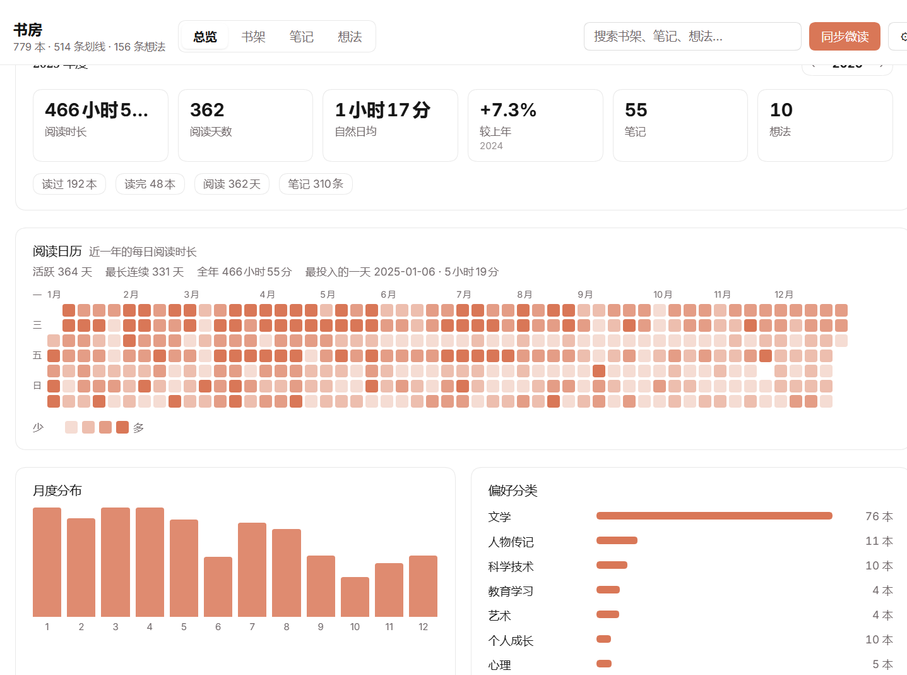

# 数字书房 · dsh-weread-gather

把微信读书的账号数据同步到本地，在 DSH 侧栏里变成一个能翻、能搜、能带走的私人书房：
书架按大类陈列，每本书能展开自己的划线笔记与想法，总览页按年份联动展示阅读热力图与表盘，
选中的内容可以导出成带 front-matter 的 Markdown，整份书房也能一键备份与恢复。

下一步（**1.2.1，开发中、尚未发布**）把它往「以书为轴的阅读关系工作台」推一步：让书里的划线、我写下的想法、我采纳的那句话被指出**彼此之间的关联**，攒成线索，再落回作品或回到原文——让阅读不止于收藏，让思考不止于理解，让写作不止于生成。

- 侧栏入口「数字书房」（`sidebar.panellist`，order 26），主面板同 key 打开
- 宿主侧持有 API Key 与全部数据，页面只读自己的同源 JSON 接口
- 不写回微读，不做任何上报；数据只落在本机 `$DSH_HOME/weread-gather/`

## 界面

书架：10 个大类、每行 10 本，按年份与关键词筛选。


总览：置顶的年度阅读热力图，KPI、月度分布与表盘都跟着右上角的年份切。

配色默认是浅绿纸感（页面 `#F6F8F7`、强调绿 `#4F9274`、热力图五档 `#EDF2EF → #438765`），DSH 的 `--dsw-alias-*` token 仍被重映射，避免与宿主的状态色打架。

> **1.2.1 开发中（尚未发布）**：「设置 → 外观」提供**五套预设**（`glacier` / `mint` / `night` / `mist` / `iris`，取自原型；`glacier` 为默认），切换即时生效并记住选择；深色的 `night` 单独校验过对比度。**没有「跟随宿主」这一档**——面板有自己的纸感体系，跟着宿主主题走只会让书房在你没动它的时候突然变色；配置里缺失或写了不认识的名字时一律渲染 `glacier`。已发布版本（1.1.5）还没有这个开关。



## 四段旅程（1.2.1 开发中，未发布）

1.2.1 把导航分成两层：**上面是四段旅程，下面是视图**。现有四页不消失，只是降为 READ 的内页（一层可见、随时可切）。

| 旅程 | 这一段在问什么 | 产物 | 现状 |
| --- | --- | --- | --- |
| **READ 阅读** | 我读过什么、当时说过什么？ | 书架 / 划线 / 想法 / 导出（现在的四页）+ 书页的「我的阅读脉络」 | ✅ 四页已可用；脉络开发中 |
| **THINK 思考** | 这条记录能和书里哪些地方一起看？我到底怎么想？ | 「放回书里看」——就地展开的对话，产出 1–3 条**关系**（带两端出处 + 一句理由），以及我采纳的那句话 | ⏳ 开发中（未发布） |
| **CREATE 创作** | 这些关系能写成什么？ | **线索**（标题 + 为什么值得回看 + 覆盖范围）→ 初稿（逐段出处、AI 逐段采纳）→ 导出 Markdown；也可以从线索**回到原文** | ⏳ 开发中（未发布） |
| **GROW 生长** | 这段时间我长出了什么？ | 时间线（含关系与线索）+ 年度回顾 | ⏳ 开发中（未发布） |

> 上表描述的是 1.2.1 的**目标形态**；已发布版本（1.1.5）只有 READ 那一行是真的，其余三段仍标「开发中」——分支上的代码未发布，请不要当成现成功能。
>
> 1.2.1 中途调整过一次定位（2026-11-11）：原来打算做「素材 → 选题 → 作品」的产线，现在改成**关系网**——重点是「两条记录为什么能放在一起」，素材与选题因此不再出现在界面上（数据仍保留，供作品溯源与导出）。

四条不动的原则：

- **以「书」为轴**：每本书串起 摘录 → 想法 → **关系 → 线索** → 作品 → 回顾；任何新资产都能回溯到它来自哪本书、哪条划线（「出自」永远点得回去）。
- **关系要有理由**：每条关系都必须带两端记录的 ID 和一句「为什么值得放在一起」。说不出理由的相关，就是推荐，不是关系网——所以这里没有「猜你喜欢」。
- **写作不止于生成**：AI 只给候选，草稿由人来写；采纳过的段落带 AI 标记，手改不会把标记擦掉；导出的 `containsAI` 反映真实情况。
- **不做阅读挑战**：没有打卡、连续天数、排行榜、徽章——这一版只做「有用的产出」，不做「催更的压力」。

> 下表「功能」描述的是**已发布版本（1.1.5）**；上面这四段里除 READ 之外，1.2.1 都还没发布。

## 安装

要求 **DSH >= 0.2.2-rc.1**（Web 端），插件是纯 JS、无构建步骤，装完重启即生效。

```bash
# 1) 从 npm 安装
dsh plugin --profile <你的 profile> add dsh-weread-gather

# 2) 或者直接从 GitHub 装
dsh plugin --profile <你的 profile> add github:fountainhead-gq/dsh-weread-gather
```

也可以把 Release 里的 `.tgz` 拖进设置页，或指向本地源码目录：

```bash
dsh plugin --profile <profile> add link:D:/path/to/dsh-weread-gather
```

装好后重启 DSH，侧栏出现「数字书房」。首次打开会让你填 **微信读书 Agent 网关的 API Key**（`wrk-` 开头）：

- 优先读进程环境变量 `WEREAD_API_KEY`（DSH 应用进程里配好就不用手填）
- 否则在「书房 → 设置」里粘贴，存到本机 `config.json`
- Key 只在宿主侧使用，永远不会进入页面；`/state` 返回的是掩码

## 功能

| 区域 | 内容 |
| --- | --- |
| 总览（表盘） | **整页按年份联动**：右上 `‹ 2026 ›` 切年，六格 KPI（阅读时长 / 阅读天数 / 日均 / 较上年 / 当年笔记 / 当年想法）、**置顶的年度阅读热力图**（365 天逐日、活跃天数 / 最长连续 / 全年时长 / 最投入的一天）、12 个月月度分布、偏好分类条、读得最多 8 本、偏好作者 6 位、文字/听书比例环形表盘；累计时段分布不随年份变化（接口只提供 all-time） |
| 书架 | 全部书籍按 **10 个大类** 陈列（文学/其他/艺术/科技/成长心理/历史/生活/社科/经管理财/哲学宗教），**每行 10 本**、窄屏自动降为 8/6/4 本；支持按书名/作者/分类搜索、**按最后阅读年份筛选**（也可直接在搜索框输入「2024」）、按最近阅读/笔记数/书名排序，卡片显示封面、分类、评分、出版社、出版年、笔记条数 |
| 笔记 | 全部划线按时间倒流，**每页 24 条翻页**、按书筛选、关键词搜索、**单条复制**、**点卡片跳到该书详情** |
| 想法 | 想法卡片墙（瀑布流式多列），**每页 20 条翻页**、按书筛选、关键词搜索、**单条复制**、**点卡片跳到该书详情（自动切到想法页）**、星级与章节 |
| 书籍详情 | 封面、作者、大类 + 细分分类/读完/评分/出版社/出版年徽章、简介、该书全部划线 + 想法（每页 24 条翻页、可复制）、一键在微读打开、**「导出这本书」直接生成整本 Markdown** |
| 全局搜索 | 顶栏搜索同时搜书名、作者、分类、划线正文、想法正文；结果按**书籍 / 划线 / 想法**分类切换，命中的关键词在卡片里高亮 |
| 导出 Markdown | 划线/想法卡片左上角圆圈勾选（悬停出现）→「导出所选」；也可「导出全部结果」或只导出某一本。导出面板可关掉原文/想法/书籍信息/章节标题/星级/微读链接，**先预览前 30 行**，再选择复制、下载 `.md` 或直接保存到导出目录（默认 `$DSH_HOME/weread-gather/exports/`，同名自动加 `-2` 序号） |
| 同步提示 | 同步进行中在页面顶部显示进度条，完成后停留 8 秒自动消失，也可以随时点右侧 `×` 关掉；数据没变化时同步只花 2~3 秒 |
| 设置 | 展示 Key 来源（环境变量或手填）、书架上限、每本书同步笔记条数、单次补全书籍信息上限、**Markdown 导出目录**、**下载备份 / 导入备份（两步确认，导入前自动另存当前数据）**、清空数据 |

每一项（书架/笔记/想法/搜索/书籍详情内的列表）都有自己的搜索框；顶栏搜索是跨模块的全局搜索。

### 分类是怎么折到 10 个的

微读自己的分类是几十个叶子（`文学-文学鉴赏` 这种），直接铺成 chip 没法用。宿主侧按「-」前的上级前缀把每本书折进一个书架大类，`book.group` 存大类，`book.category` 保留叶子值（详情页和搜索仍用得到）。折叠表在 `index.js` 的 `CATEGORY_GROUPS`，改一行就能调；分组是**加载时派生**的，不需要重新同步。

## 导出成什么样

导出的 Markdown 是「能进别人工具链」的格式，不只是一坨文字：

```markdown
---
title: "顾随诗词讲记"
author: "顾随"
bookId: "3300220853"
source: "weread"
sourceUrl: "weread://reading?bId=3300220853"
category: "文学-文学鉴赏"
exportedAt: "2026-11-08T19:10:00+08:00"
excerptCount: 1
thoughtCount: 1
containsAI: false
exportId: "weread:book/3300220853"
contentHash: "sha256:ece983…"
tags: ["微信读书"]
---

# 顾随诗词讲记

*顾随*

## 开场白——诗之感发作用

> 诗根本不是教训人的，是在感动人，是“推”、是“化”——道理、意思不足以征服人。
> — 2026-07-28 12:52

**想法**（2026-07-28 12:55）

诗的首要目的不是教育人的，是来感动人的，最终让人意悦心服。
```

几条约定，都是为了以后能被机器稳定识别：

- **块引用 `>` 只用于原文**（作者行用 `*斜体*`，不占用引用），原文末行固定是 `> — 划线时间`
- **`**想法**（时间）` 只用于你自己写的内容**；AI 生成内容带独立标记，`containsAI` 就是给这件事留的开关（当前版本恒为 `false`，1.2.1 规划中的作品导出会按真实情况写它）
- 字段有就写、没有就省略正文那一行；front-matter 里缺值写 `""`，**绝不猜、不写「未知」**
- `exportId` 是这条导出在书房里的身份（`weread:book/<bookId>` 或批量 `weread:selection/<hash>`），`contentHash` 是内容指纹（工时不变、换时间导出也不变），为 1.3.0 的「更新已有笔记」做准备
- 批量导出时一个文件里多本书，每本以 `# 《书名》` 开头、彼此用 `---` 分隔

## 数据从哪来

走微信读书的 Agent 网关（`https://i.weread.qq.com/api/agent/gateway`），全部只读：

- `/shelf/sync` — 书架、分类、书单归档
- `/book/info` — 补全 `category / intro / publisher / publishTime / newRating`（`/shelf/sync` 的 category 大多为空，所以这一步很关键；一次 400 本，失败的 7 天后重试）
- `/book/bookmarklist` — 每本书的划线
- `/review/list/mine` — 每本书的想法
- `/readdata/detail` — weekly / monthly / annually / overall 四套阅读统计

热力图与年度视图不靠同步时的四套统计（它们的 `dailyReadTimes` 实测是空的），而是按需拉：

- `mode: 'monthly'` + 每月 1 号的 `baseTime` → 该月逐日秒数（`readTimes`），12 次拼成一整年
- `mode: 'annually'` + 该年 1 月 1 日 → 年度聚合（时长/天数/日均/月度分布/偏好分类/偏好作者/读得最多）

这两类结果缓存在 `heat.json`：**已过年份永久缓存**，当年缓存 30 分钟后过期重取，所以切年份几乎瞬时。

### 同步是增量的

每次同步先读 `sync-state.json` 这本账，只处理「真的变了」的书：

- 书架、分类、笔记本清单每次都读（清单约 5 个请求，且它是未在书架前 400 本里的书的主要来源，所以不能提前停）
- 四套阅读统计 **6 小时**内直接复用，不重新请求
- 每本书按 `lastNoteTime / noteCount / reviewCount` 三项比对：没变化的书**不重拉划线**，旧划线/想法直接沿用
- 单次最多细读 `maxBooks` 本（默认 60）；账本会记下还有多少本从未细读过（`pending`），需要补齐时在设置里点「强制全量重建」

实测：本机 779 本 / 694 条划线的库，首次全量约 8.4 秒，之后没有变化的同步 **2~3 秒**（`更新 0 本 · 跳过 470 本`）。

## 数据落点与隐私

```
$DSH_HOME/weread-gather/
  config.json   手填的 apiKey、maxBooks、notesPerBook、metaLimit、exportDir
  data.json     书架 + 分类 + 划线 + 想法 + 阅读统计
  meta.json     每本书的元信息缓存（bookId -> 分类/简介/出版社/出版年/评分）
  heat.json     逐年热力图与年度聚合缓存（{ "2025": { v, at, days, annual } }）
  sync-state.json  同步账本（上次同步时间、每本书的计数与是否细读过、统计缓存时间）
  exports/      Markdown 导出（默认目录，可在设置里改）
  backups/      导入备份前自动留存的旧数据（<时间戳>/ 五个 JSON）
```

> 1.2.1（开发中）会在这个目录里再加一个 `craft.json`，存**关系 / 线索**、作品与回应（素材与选题的数据也在里面，但界面不再提供这两个入口）。它和上面这些原始数据物理隔离：摘录与想法只被读、不被改写。**当前版本还没有这个文件。**

- 所有数据都在这一个目录里，插件不写别处；`data.json` 只在同步时整体重写，页面读内存副本
- API Key 以明文存在本机的 `config.json`（和许多本地 CLI 一样），只用它向微读网关发请求
- 插件不包含任何遥测、不上传任何内容；卸载插件后删掉这个目录即彻底清空
- 仓库里不含任何真实书籍数据或 Key（`.gitignore` 已排除这四个 JSON）

## HTTP 接口

前缀 `/dsh-weread/api`（同源相对路径，客户端直接 fetch）：

| 方法 | 路径 | 作用 |
| --- | --- | --- |
| GET | `/state` | 是否已配置、Key 掩码、版本、数据量、同步进度、各项上限、导出目录 |
| GET | `/data` | 整份书房数据（含 `years`：可选的年份及各自总时长） |
| GET | `/heat?year=2026` | 该年逐日阅读秒数 `days` + 年度聚合 `annual`（带缓存，见上） |
| POST | `/export` | `{ selector, options, mode }`：`selector` 用 `bookIds` / `noteIds` / `thoughtIds`，`mode: 'preview'` 只回 Markdown、`'file'` 落盘；**空 selector 会报错，不会导出全部** |
| GET | `/export/dir` | 当前导出目录与是否已存在 |
| POST | `/export/dir` | 改导出目录（会先写探针文件确认可写，失败回滚） |
| GET | `/backup` | 一次性备份包 `{ format, files: { config/data/meta/heat/sync-state } }`，`config.json` 已剔除 apiKey |
| POST | `/restore` | `{ bundle }`：校验后先复制旧数据到 `backups/<时间戳>/`，再写回；config 合并时保留本机 apiKey |
| POST | `/sync` | 触发一次同步（异步，立刻返回进度；用 `/state` 或 `/sync` 轮询）。`{ "full": true }` = 忽略账本强制全量重建 |
| POST | `/config` | 改 apiKey / maxBooks / notesPerBook / metaLimit |
| POST | `/reset` | 清掉手填的 Key |

路由注册在 `ctx.effect(...)` 里，插件停用/重载时会正确注销（早先直接 `return disposer` 是不生效的，会留下 `duplicate prefix route` 泄漏）。

## 开发自检

```bash
node --check index.js && node --check client.js   # 语法
node scripts/check.cjs                            # 组件引用 / locale 键对称 / 宿主-客户端契约 / 包身份一致性
node scripts/render-smoke.cjs                     # 用极简 hooks 运行时把 11 种视图各渲染一遍
node scripts/export-selftest.cjs                  # 45 项 Markdown 导出断言（front-matter、哈希、批量、隔离）
node scripts/sync-selftest.cjs                    # 10 项增量同步断言（重拉判定、账本搬运），不联网
```

三个脚本都不依赖浏览器：`render-smoke.cjs` 自建了极简 hooks 运行时，把 `client.js` 放进 `vm` 里逐个视图渲染，断言不会退化成加载态、笔记/想法必须带分页与复制控件；`export-selftest.cjs` 直接 `import` 宿主的 `__internals`，拿真实 `data.json` 跑导出断言。两者默认读 `~/.dsh/weread-gather/data.json`，可用 `WEREAD_DATA` 指到别的数据文件（需要一个已经同步过的数据集）。

## 已知限制

- 1.2.1 的四段旅程（READ / THINK / CREATE / GROW）与读写闭环**尚未发布**：已发布版本只有 READ 这一段的能力，四页仍是顶栏平铺的入口。
- 1.2.1 的「放回书里看」**没有向量库**：召回靠同书 + 章节邻近 + 字面重合粗排，交模型判断联系是否成立。它做不到「读懂了意思再找相似」——书里换个说法讲同一件事，它可能接不上；这也是为什么每条关系都要写理由，让你一眼看出它凭哪句话这么说。
- 「其他」桶里的书是微读自己的数据缺口：多半是 `CB_` 前缀的导入文档 / PDF，`/book/info` 也不返回分类，无法自动归类。
- 笔记同步按「最近有笔记的 N 本书」（默认 60 本）展开，不是全量；账本会记下还有多少本从未细读过（同步结果里的 `pending`）。想补齐就在设置里点「强制全量重建」，或把 `maxBooks` 调大（代价是请求数线性增长）。
- 增量同步依赖 `sync-state.json` 这本账；删掉它不会丢数据，但下一次同步会按全量走一遍。
- 主题：DSH 的 `--dsw-alias-*` token 仍被重映射以对齐状态色；1.2.1 的「外观」五套预设自己定义纸色（不再是「跟随宿主」），所以宿主切亮/暗主题时书房不会跟着变色。
- `/book/info` 实测不返回字数（文档有写、回包里没有），所以卡片上用的是出版年而不是字数。
- 微读的 `/readdata/detail` 只在 `mode: overall` 时给 24 小时时段分布，年/月/周都返回空数组，所以「阅读时段」那张图只能展示累计值，不随年份切换（标题里有标注）。
- 切到往年后，本周/本月两张卡会隐藏——它们本来就是「当前」的概念；往年的信息由年度 KPI 与月度分布承载。
- 当年热力图首次打开要发 13 个请求（12 个月 + 1 次年度聚合），之后读缓存；已过年份只发一次。

## 说明

非微信读书官方项目，只用只读接口读取你自己的账号数据。使用前请确认这符合你账号所在地的服务条款。

## License

[MIT](./LICENSE)